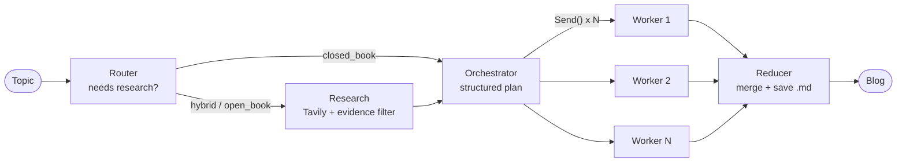

# Blog Writing Agent

**A multi-agent AI system that researches a topic on the web, plans a structured outline, writes every section in parallel, and delivers a cited technical blog in about a minute.**

Built with **LangGraph**, **Groq (gpt-oss-120b)**, **Tavily web search** and **Streamlit**.

**Live demo:** _coming soon_


---

## What it does

Type a topic such as *"State of Multimodal LLMs in 2026"* and the agent:

1. **Decides whether it needs the web.** Evergreen topics are written from model knowledge; fast-moving topics (news, "latest", pricing, rankings) trigger research.
2. **Researches with Tavily** and keeps a deduplicated set of real sources.
3. **Plans the blog** as structured data: title, audience, tone and 5–9 sections, each with a goal, concrete bullet points and a word budget.
4. **Writes all sections in parallel**, one worker per section, citing only the URLs it found.
5. **Merges and saves** the blog as Markdown, ready to download.

The Streamlit UI shows each step live (routing, research, planning, "wrote section 3/7") and has tabs for the finished blog, the plan and the sources.

Sample output: [`blogs/state_of_multimodal_llms_in_2026.md`](blogs/state_of_multimodal_llms_in_2026.md), with 7 sections and 26 source links.

## Architecture



| Node | Responsibility | Key technique |
|---|---|---|
| **Router** | Classifies the topic as `closed_book`, `hybrid` or `open_book` and writes search queries | Structured output (Pydantic) + conditional edge |
| **Research** | Runs Tavily searches, keeps relevant sources, removes duplicates | LLM as an evidence filter |
| **Orchestrator** | Produces the full plan in a single call | Pydantic schema with field-level constraints (`min_length`, `Literal`) |
| **Workers** | Each writes one section, following its goal, bullets and word budget | Dynamic fan-out with LangGraph `Send` |
| **Reducer** | Orders the sections and saves the final Markdown | `operator.add` state reducer for parallel writes |

## Engineering highlights

- **Orchestrator-worker pattern with dynamic fan-out.** The number of parallel workers is decided at runtime by the plan. LangGraph's `Send` gives each worker only the payload it needs, and an `operator.add` reducer collects results safely from concurrent branches.
- **Grounded writing.** Workers may cite only URLs returned by the research step, which cut down invented APIs and facts compared with the no-research version.
- **Prompt and schema design as the quality lever.** The plan schema (goal, 3–5 actionable bullets, target words, section type) and separate prompts for planning versus writing turned generic output into structured, technical posts.
- **Running on a free-tier LLM.** Groq's free tier allows 8k tokens/minute, which parallel workers exceed. Client-side retries with backoff, compact research payloads and retries on malformed tool calls make the pipeline finish reliably.
- **Live progress streaming.** The UI consumes `graph.stream(stream_mode="updates")`, so one graph run powers both the progress feed and the final result.

## Tech stack

| Layer | Tools |
|---|---|
| Orchestration | LangGraph (StateGraph, conditional edges, `Send`, reducers) |
| LLM | Groq `openai/gpt-oss-120b` via `langchain-groq` |
| Web research | Tavily via `langchain-tavily` |
| Data validation | Pydantic v2 structured outputs |
| UI | Streamlit |

## Project structure

```
blog-writing-agent/
├── agent.py           # LangGraph pipeline: schemas, nodes, graph
├── app.py             # Streamlit UI with live progress
├── blogs/             # Generated blogs (Markdown)
├── requirements.txt
└── .env.example       # API keys template
```

## Run locally

```bash
git clone https://github.com/msdianprince-7/blog-writing-agent.git
cd blog-writing-agent
python -m venv venv
venv\Scripts\activate          # macOS/Linux: source venv/bin/activate
pip install -r requirements.txt
copy .env.example .env         # macOS/Linux: cp .env.example .env, then add your keys
streamlit run app.py
```

You need free API keys from [Groq](https://console.groq.com/keys) and [Tavily](https://app.tavily.com/).

## Acknowledgements

The graph design follows the [CampusX blog-writing-agent](https://github.com/campusx-official/blog-writing-agent) tutorial. This version is adapted to run on Groq and Tavily's current SDK, and adds rate-limit handling, a lean Streamlit UI with live progress and Windows-safe file naming.

## License

MIT
